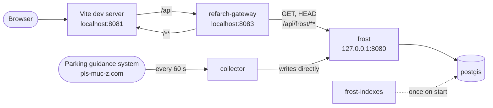

<!-- add Project Logo, if existing -->

# Parkhausradar, Munich's parking guidance system online

[![Made with love by it@M][made-with-love-shield]][itm-opensource]
<!-- feel free to add more shields, style 'for-the-badge' -> see https://shields.io/badges -->

Live occupancy of the parking garages in Munich's city center on an interactive map - mobile first, with traffic-light markers, a detail panel and direct route planning via common map providers.

> **Note:** This project is currently being rebuilt. The previous prototype is archived in the [`archive-prototype`](https://github.com/it-at-m/parkhausradar/tree/archive-prototype) branch.

### Built With

- Frontend: [Vue 3](https://vuejs.org/), [Vuetify](https://vuetifyjs.com/), [MapLibre GL JS](https://maplibre.org/) with a [Protomaps](https://protomaps.com/) basemap, built with [Vite](https://vite.dev/)
- Backend: [FROST-Server](https://github.com/FraunhoferIOSB/FROST-Server) (OGC SensorThings API) on [PostGIS](https://postgis.net/), filled by a Python collector, behind the [RefArch gateway](https://github.com/it-at-m/refarch)

## Set up

The frontend lives in `frontend/` and needs npm 11.6 or newer. There are two ways to run it:

| Command (in `frontend/`) | Data |
| --- | --- |
| `npm run dev` | Simulated parking garages, answered by the dev server |
| `npm run dev:stack` | Real data from the local stack behind the RefArch gateway |

### Simulated data (`npm run dev`)

The dev server answers the FROST requests of the app itself, in exactly the format of the FROST-Server. The simulation lives in `frontend/simulator/` and never ends up in the production build.
Ten made-up garages change their values every minute, some of them with typical data quality problems like a frozen counter.

### Local stack (`npm run dev:stack`)

`stack/` starts the backend locally with Docker Compose, as in production:



| Service | Purpose | Local URL |
| --- | --- | --- |
| `collector` | Writes the current occupancy to FROST every minute, see [Collector](#collector) | none |
| `postgis` | Database of the FROST-Server | internal only |
| `frost-indexes` | Adds the database indexes FROST does not create itself, see [`stack/frost-indexes.sql`](stack/frost-indexes.sql), then exits | none |
| `frost` | SensorThings API with the parking garages and their observations | http://127.0.0.1:8080/FROST-Server/v1.1
| `refarch-gateway` | Read-only access to FROST under `/api/frost` (`GET` and `HEAD`, otherwise `405`), as in production | http://127.0.0.1:8083/api/frost/v1.1 |

```bash
cd stack
docker compose up -d
```

## Documentation

### Architecture

The collector fetches the occupancy from the [data source](#data-sources) every minute and writes it to the FROST-Server, which stores it in PostGIS. The frontend reads the garages and their latest values from FROST through the RefArch gateway, which only allows reading. The [local stack](#local-stack-npm-run-devstack) shows the components as a diagram.

### Deployment

TBD

### Data Sources

The occupancy comes from the parking guidance system of Munich: [pls-muc-z.com/pls/info/parkhaus.txt](https://pls-muc-z.com/pls/info/parkhaus.txt), one tab separated line per garage with serial number, connection, P-Number, name, free spaces and capacity. The source has no timestamp and does not mark offline counting systems.

### Collector

`collector/` is a small Python service without dependencies that runs permanently. It

1. creates or updates a Thing with its Locations and Datastreams in FROST for every garage in [`collector/garages.json`](collector/garages.json) once on start,
2. fetches the source every 60 seconds and writes the free spaces and the capacity as one Observation each, with the time of the request, in one `CreateObservations` request (SensorThings Data Array extension).

The garages, keyed by P-Number, live in `collector/garages.json` and are versioned with the code. Garages of the source that are missing there are skipped. They are listed in the log on start and whenever the list changes. An entry looks like this, coordinates as `[longitude, latitude]`:

```json
{
  "pNumber": "P99",
  "name": "Musterparkhaus",
  "address": "Musterstraße 1, 80331 München",
  "operatorUrl": "https://example.com",
  "location": [11.5658, 48.1391],
  "entrances": [[11.5655, 48.1393]]
}
```

`address` and `operatorUrl` may be `null`. A failed run is logged and repeated a minute later, starting again with step 1, so the collector also recovers after FROST was unavailable or reset.

The collector writes directly to FROST, configured by `FROST_URL` (e.g. `http://frost:8080/FROST-Server/v1.1`). Run the tests in `collector/` with `python -m unittest discover -s tests`. The CI additionally runs `ruff check` and builds the image `collector:dev` on `main`, like for the frontend.

### Basemap

The map is served entirely from our own server, so no request of a citizen reaches a third party. It is a [PMTiles](https://docs.protomaps.com/pmtiles/) extract of the [Protomaps basemap](https://github.com/protomaps/basemaps) for the city of Munich, generated from OpenStreetMap.

The tileset (~36 MB) is too large for Git. It is published as an asset of a GitHub release and referenced in [`frontend/basemap.json`](frontend/basemap.json) by URL and SHA-256 checksum. `npm run build` and `npm run dev` download it into `frontend/public/map/` and abort if the checksum does not match.

To update the basemap:

1. Run `scripts/build-basemap.sh <YYYYMMDD>` in `frontend/` with a build date from [maps.protomaps.com/builds](https://maps.protomaps.com/builds). It requires the [pmtiles CLI](https://github.com/protomaps/go-pmtiles) and updates `basemap.json`.
2. Create the release `basemap-<YYYYMMDD>` with the generated file as asset. Do not mark it as latest release, and state the license in the release notes (ODbL, © OpenStreetMap contributors, source build).
3. Open a pull request with the updated `basemap.json` and check the map visually before merging.

## Contributing

Contributions are what make the open source community such an amazing place to learn, inspire, and create. Any contributions you make are **greatly appreciated**.

If you have a suggestion that would make this better, please open an issue with the tag "enhancement", fork the repo and create a pull request. You can also simply open an issue with the tag "enhancement".
Don't forget to give the project a star! Thanks again!

1. Open an issue with the tag "enhancement"
2. Fork the Project
3. Create your Feature Branch (`git checkout -b feature/AmazingFeature`)
4. Commit your Changes (`git commit -m 'Add some AmazingFeature'`)
5. Push to the Branch (`git push origin feature/AmazingFeature`)
6. Open a Pull Request

More about this in the [CODE_OF_CONDUCT](/CODE_OF_CONDUCT.md) file.


## License

Distributed under the MIT License. See [LICENSE](LICENSE) file for more information.

The basemap data and icons in `frontend/public/map/` are third-party content under their own licenses (ODbL, MIT). See [`frontend/public/map/LICENSE.md`](frontend/public/map/LICENSE.md).


## Contact

it@M - opensource@muenchen.de

<!-- project shields / links -->
[made-with-love-shield]: https://img.shields.io/badge/made%20with%20%E2%9D%A4%20by-it%40M-yellow?style=for-the-badge
[itm-opensource]: https://opensource.muenchen.de/
